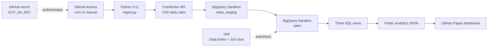

# Forex Volatility Pipeline

An explainable cloud-computing course project that collects USD exchange rates, stores them in BigQuery Sandbox, calculates volatility in SQL, and publishes a daily dashboard.

> **Zero-cost compatibility note (verified 20 October 2026):** the original brief requested both “no billing account” and a direct Looker Studio–BigQuery connection. Google now states that this connector requires a project linked to a Cloud Billing account. To preserve the selected **no credit card / no billing** requirement, this build uses a static GitHub Pages dashboard instead. It contains the same three requested charts and is refreshed by the daily workflow. See [Google's connector requirement](https://docs.cloud.google.com/data-studio/connect-to-google-bigquery#before_you_begin).

## 1. Project folder structure

```text
forex-volatility-pipeline/
├── .github/
│   └── workflows/
│       └── daily.yml           # Daily/manual serverless runner
├── pipeline/
│   └── ingest.py               # The only Python script
├── sql/
│   └── views.sql               # Three BigQuery analytics views
├── docs/
│   ├── index.html              # Framework-free GitHub Pages dashboard
│   └── data.json               # Public analytics snapshot generated daily
├── requirements.txt
└── README.md
```

## 2. Complete files and architecture

Every file above is complete and ready to copy. The Python code uses only `requests` and `google-cloud-bigquery`. The dashboard uses browser HTML, CSS, JavaScript, and Canvas—no framework or paid chart service.



### Idempotency

BigQuery Sandbox currently rejects DML statements, including `MERGE`, and also rejects streaming inserts. The script therefore:

1. batch-loads API rows into `rates_staging` with `load_table_from_json` and `WRITE_TRUNCATE`;
2. performs a read-only `LEFT JOIN` against `rates` on `(rate_date, currency)`;
3. batch-loads only missing keys into `rates` with `WRITE_APPEND`.

The workflow's concurrency group permits only one writer at a time, preventing two jobs from passing the existence check together. Running the same date twice therefore appends zero duplicates.

## 3. Beginner step-by-step guide

### A. Create a no-billing BigQuery Sandbox project

1. Go to [BigQuery Studio](https://console.cloud.google.com/bigquery) and sign in with a Google account.
2. On the Sandbox welcome page, choose your country, accept the terms, and click **Agree and continue**.
3. Click **Create project**. Name it `forex-volatility-pipeline`, choose **No organization** if appropriate, and click **Create**.
4. Return to BigQuery Studio. Expect a banner saying that you are using BigQuery Sandbox. **Do not click Upgrade and do not attach a billing account.**
5. Copy the immutable **Project ID** shown near the project name. It may contain numbers and differs from the display name.

If you do not see the Sandbox banner, open **Billing** for the project and verify that no billing account is linked before continuing. Google documents Sandbox as working without a card or billing account.

### B. Create the `forex` dataset

1. In BigQuery Studio's **Explorer**, find your Project ID and click its three-dot menu.
2. Click **Create dataset**.
3. Enter Dataset ID `forex`.
4. For Location type choose **Multi-region**, and select `US`.
5. Leave the remaining settings at their defaults and click **Create dataset**.
6. Expect `forex` to appear beneath the project. Sandbox applies its own expiration rules; do not try to enable paid storage.

### C. Create a least-privilege service account

1. Open **Navigation menu → IAM & Admin → Service Accounts**.
2. Click **Create service account**. Name it `forex-pipeline`, then click **Create and continue**.
3. Do not grant a broad project role on this screen. Click **Done**.
4. Open **IAM & Admin → IAM**, then click **Grant access**.
5. In **New principals**, paste the service-account email. Select **BigQuery Job User**, then click **Save**. This project-level role permits query and load jobs, but does not grant access to table contents by itself.
6. Return to BigQuery Studio. Beside the `forex` dataset click the three-dot menu → **Open** → **Sharing** → **Permissions** → **Add principal**.
7. Paste the same service-account email. Select **BigQuery Data Editor** and save. This dataset-level role permits creating and updating only objects inside `forex`.
8. Return to **IAM & Admin → Service Accounts**, click `forex-pipeline`, open **Keys**, then **Add key → Create new key → JSON → Create**.
9. A JSON file downloads once. Keep it private. Never upload, paste, screenshot, or commit it.

The JSON key proves that the GitHub runner is this service account. A public repository exposes its entire history forever, so a committed key must be treated as compromised. A GitHub Actions secret encrypts the value, supplies it only to the job, and prevents it from appearing in the repository. The workflow writes it to a temporary, owner-only file and deletes that file before the step ends.

### D. Create the public GitHub repository

1. Sign in to GitHub and click **+ → New repository**.
2. Name it `forex-volatility-pipeline`, select **Public**, and click **Create repository**. Standard GitHub-hosted Actions are free for public repositories.
3. Upload the contents of this project folder, preserving `.github/workflows/daily.yml`. Do **not** upload the downloaded JSON key.
4. Commit to the `main` branch. Expect the folders shown in the structure above.
5. Open **Settings → Actions → General**. Under **Workflow permissions**, select **Read and write permissions**, then save. This lets the workflow commit only the public `docs/data.json` snapshot.

### E. Add the service-account key as a secret

1. Open the repository's **Settings → Secrets and variables → Actions**.
2. Click **New repository secret**.
3. Name it exactly `GCP_SA_KEY`.
4. Open the downloaded JSON key locally, copy its complete contents from `{` to `}`, paste it into **Secret**, and click **Add secret**.
5. Expect the secret name to be visible but not its value. Delete the downloaded local key only after confirming the workflow works; revoke and replace it if it was ever exposed.

### F. Run the 90-day backfill

1. In GitHub open **Actions → Daily Forex Pipeline → Run workflow**.
2. Choose branch `main`, tick **Load the last 90 days**, and click **Run workflow**.
3. Open the new run and the `ingest` job. Expect the Python step to log a fetched-row count and an appended-row count. The first run also says `SQL views do not exist yet; dashboard export skipped`; that is expected.
4. The API returns one row per available date and currency. The exact count can vary with source coverage; do not expect exactly 630.

### G. Check the BigQuery table

1. Return to BigQuery Studio and refresh Explorer.
2. Expand `forex`. Expect tables `rates` and `rates_staging`.
3. Click `rates` → **Schema**. Expect exactly `rate_date DATE`, `currency STRING`, `rate FLOAT`, and `loaded_at TIMESTAMP`.
4. Open a new SQL query, replace `YOUR_PROJECT_ID`, then run:

```sql
SELECT MIN(rate_date) AS first_date,
       MAX(rate_date) AS last_date,
       COUNT(*) AS rows_loaded
FROM `YOUR_PROJECT_ID.forex.rates`;
```

Expect roughly 90 calendar days of recent history across seven currencies.

### H. Create the three analytics views

1. Open `sql/views.sql` in GitHub or locally and copy all of it.
2. In BigQuery Studio click **SQL query**, paste the file, and use Find/Replace to replace every `YOUR_PROJECT_ID` with your actual Project ID—without quotation marks.
3. Click **Run**. Expect three successful statements.
4. Refresh `forex`. Expect views `daily_returns`, `rolling_volatility`, and `currency_ranking`.
5. Click each view → **Preview**. `daily_returns` includes `normalized_rate`; `rolling_volatility` includes `is_latest`; `currency_ranking` has seven currency rows when sufficient data exists.

### I. Generate and publish the live dashboard

1. Return to GitHub **Actions → Daily Forex Pipeline → Run workflow**.
2. Leave **Load the last 90 days** unticked and run it manually.
3. The ingestion should append only currently missing keys. The export queries the three views, updates `docs/data.json`, and the final step commits that public snapshot to `main`.
4. Open **Settings → Pages**. Under **Build and deployment**, choose **Deploy from a branch**. Select branch `main`, folder `/docs`, and click **Save**.
5. Wait for the Pages deployment to finish. GitHub shows a URL similar to `https://YOUR-USERNAME.github.io/forex-volatility-pipeline/`.
6. Open it. Expect:
   - a multi-series line chart using `daily_returns.normalized_rate`;
   - a bar chart of the latest seven-day volatility;
   - a current ranking table plus best/worst days from the latest 30 days.

The dashboard is “live” at the project's daily data frequency: the 18:30 UTC cron refreshes BigQuery and commits a new static snapshot. It never receives the service-account key. Frankfurter data and the dashboard snapshot are public.

## 4. Test it

### Test 1 — prove idempotency

Run the workflow manually twice with backfill unticked. On the second run, expect `appended 0 new rows` if Frankfurter published nothing new. Then run:

```sql
SELECT rate_date, currency, COUNT(*) AS copies
FROM `YOUR_PROJECT_ID.forex.rates`
GROUP BY rate_date, currency
HAVING COUNT(*) > 1;
```

Expected result: **No rows**. That proves each date/currency key is unique after repeated runs.

### Test 2 — make the API fail clearly

1. Temporarily edit `pipeline/ingest.py` and change `API_URL` to `https://api.frankfurter.dev/v2/not-a-real-endpoint`.
2. Commit, manually run the workflow, and open its log.
3. Expect a failed red job and a log beginning `Forex pipeline failed`, followed by an HTTP error/traceback. No BigQuery load occurs because the API is called first.
4. Revert the URL and commit again.

### Test 3 — prove least privilege is enforced

1. In BigQuery Studio open `forex → Sharing → Permissions` and remove the service account's **BigQuery Data Editor** access.
2. Manually run the workflow.
3. Expect a failed job with a `403 Access Denied` or `Permission ... denied` message when it tries to access the dataset/table.
4. Restore **BigQuery Data Editor** on `forex`, rerun, and expect success. Do not remove your own owner access.

You can similarly remove **BigQuery Job User** in IAM to demonstrate that table access alone does not permit jobs; restore it afterward.

## 5. Cloud concepts explained

A **data warehouse** is designed to scan and summarize analytical data; a normal transactional database such as MySQL is optimized for frequent small application reads and writes. BigQuery is **serverless**: Google operates the servers, while we submit jobs and SQL. This project uses **ETL/ELT**: Python extracts rates and loads clean rows, while SQL views transform them into returns and volatility inside the warehouse. GitHub Actions is a **CI/CD runner used as a scheduler**: cron starts an on-demand machine, runs the pipeline, and stops it. **IAM** decides what an identity may do; least privilege gives the service account only dataset editing and job execution. **Secrets management** keeps its JSON key encrypted outside source control. BigQuery normally uses **pay-per-query pricing**, where scanned bytes affect cost; Sandbox replaces billing with strict free quotas. **Scalability** comes from batch jobs and BigQuery's distributed query engine, so the same design can process far more rows without managing a database server. Under the **shared responsibility model**, Google secures and operates its cloud infrastructure; the student must secure the key, configure IAM, validate source data, monitor failed workflows, and avoid publishing private data.

## 6. Two-minute presentation script

“My project is called Forex Volatility Pipeline. Its purpose is to demonstrate a complete, automated cloud data workflow without a credit card.

Every day, GitHub Actions starts a temporary Python 3.11 runner. The script calls the free Frankfurter API and requests seven exchange rates with USD as the base. It batch-loads the response into a BigQuery Sandbox staging table. Sandbox blocks both streaming inserts and MERGE statements, so the pipeline uses a read-only join to compare staging with the final table. Only missing date-and-currency keys are appended with another batch load. This makes repeated runs idempotent.

BigQuery acts as the serverless data warehouse. Three SQL views calculate day-over-day percentage returns, seven-day rolling volatility, and a current currency ranking with best and worst days over thirty days. A one-time backfill loads ninety calendar days so these statistics are useful immediately.

For security, automation authenticates as a service account. It has BigQuery Job User at project level and Data Editor only on the forex dataset. Its JSON key is stored only as an encrypted GitHub Actions secret and is deleted from the temporary runner after use.

Google now requires billing for the direct Looker Studio BigQuery connector. To preserve a genuinely no-card project, the workflow exports only the public analytical results to JSON. GitHub Pages renders the requested line, bar, and ranking charts and refreshes after each daily run.

The project demonstrates serverless analytics, scheduled automation, IAM, secrets, idempotent ingestion, SQL transformation, and cloud-hosted presentation.”

### Five likely examiner questions

1. **Why a data warehouse instead of MySQL?**  
   BigQuery is built for analytical scans and window functions across historical data. MySQL is better suited to transactional application workloads.

2. **What is a service account?**  
   It is a non-human Google Cloud identity used by software. IAM roles restrict what the pipeline can do.

3. **Why not use `MERGE` for idempotency?**  
   BigQuery Sandbox currently blocks DML. The staging `LEFT JOIN` finds missing composite keys, then a batch load appends only those rows.

4. **How would this scale to millions of rows?**  
   Keep batch loading, partition `rates` by `rate_date`, cluster by `currency`, and query limited date ranges. Those production optimizations are unnecessary for this seven-currency course dataset.

5. **What happens when free Sandbox limits are reached?**  
   Jobs fail rather than creating a surprise bill because no billing account is attached. I would inspect the official quota page, reduce data/query volume, or deliberately migrate to a billed project with budgets.

## 7. Limitations and future work

- **60-day expiry:** current Sandbox documentation says every table, view, and partition automatically expires after 60 days. Before a demonstration, verify the current rule on the [official Sandbox page](https://docs.cloud.google.com/bigquery/docs/sandbox), rerun the backfill, and recreate `sql/views.sql`. If resources are near expiry, delete/recreate the course tables and views first, then backfill; remember that deleted storage does not restore Sandbox's lifetime quota.
- **Sandbox quotas:** as verified on 20 October 2026, Google lists 10 GiB lifetime storage and 1 TiB query processing per month, but limits can change. Recheck the same official page rather than relying on these numbers.
- **Static dashboard:** GitHub Pages shows the last successful daily export, not a direct BigQuery connection. A future billed version could use Looker Studio, but that would violate this build's no-card rule.
- **Daily, not trading data:** Frankfurter supplies daily reference rates, so the project measures daily volatility and cannot represent intraday market moves.
- **Coursework credentials:** a JSON key is required by the brief and must be rotated/revoked if exposed. A production version would prefer short-lived, keyless federation and stronger monitoring.

## Current free-use references

- [BigQuery Sandbox limits and 60-day expiration](https://docs.cloud.google.com/bigquery/docs/sandbox)
- [Frankfurter API v2](https://frankfurter.dev/)
- [GitHub Actions billing: public standard runners are free](https://docs.github.com/en/billing/concepts/product-billing/github-actions)
- [GitHub Pages quickstart](https://docs.github.com/en/pages/quickstart)
- [Looker Studio BigQuery billing requirement](https://docs.cloud.google.com/data-studio/connect-to-google-bigquery#before_you_begin)

Terms and quotas can change. Verify these official pages immediately before submission or demonstration.
